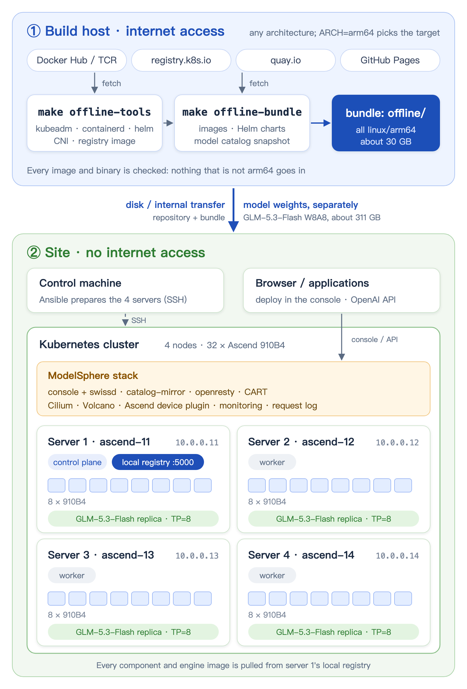

# Walkthrough: an offline install on four Ascend 910B4 servers

This guide starts from four Ascend 910B4 servers with an operating system and
nothing else, and ends with GLM-5.3-Flash (W8A8) answering requests as four
replicas, **with no internet access on site**. A build host that can reach the
internet packs everything into a bundle; the bundle is carried in; a
Kubernetes cluster and the whole ModelSphere stack are installed from it; and
the model is deployed from the web console.

It is one concrete path through what [`install.md`](install.md) and
[`offline-install.md`](offline-install.md) describe in general. Compared with
the [Docker deployment](../docker/README.md), it adds Kubernetes: deploying,
scaling, upgrading and removing a model all happen in the console, without
logging in to each server.

What you end up with:

- a 4-node Kubernetes cluster scheduling 8 × 910B4 per node
- the ModelSphere stack: gateway, cache-aware router, monitoring and alerts, and the web console
- GLM-5.3-Flash deployed from the console, 4 replicas, with the full 1M context
- a local image registry and model catalog on site, so later deploys and upgrades need no internet either

## 1. Architecture

<p align="center">
  
</p>

The work happens in three places:

- **Build host**: a Linux machine with internet access. It downloads and packs
  everything the install needs: Kubernetes components, container images, Helm
  charts and the model catalog. The bundle is then carried into the site on a
  disk or over an internal transfer.
- **Control machine**: a machine on site that can SSH to the four servers. It
  runs the node preparation (Ansible). A laptop will do, or any Linux machine on
  site.
- **Four servers**: server 1 is both the Kubernetes control plane and the local
  image registry. All four are NPU workers, each running one GLM-5.3-Flash
  replica (8 NPUs, TP=8).

Every image in the bundle is loaded into the registry on server 1, and the
cluster pulls from that registry only.

### This is a minimal install

It uses only the four NPU servers, to get the whole path working with as few
machines as possible. That suits evaluation and testing. For production, change
two things:

- **Control plane**: use three separate CPU machines as the Kubernetes control
  plane (three etcd and API server instances), and keep the NPU servers as
  workers. Here server 1 is the only control-plane node: when it fails, the
  cluster cannot be managed, and the control-plane components compete with the
  model for server 1's CPU and memory.
- **Persistent storage**: this guide does not install Ceph (`rookCeph`,
  `rookCephCluster` and `cephCsiDrivers` are off in the default environment, and
  `storage.persistence` is `false`). Monitoring data (Prometheus metrics,
  Grafana settings, Alertmanager silences) lives in emptyDirs and is lost when a
  pod restarts or moves. In production, turn those three on for at least three
  nodes with a spare raw disk, set `ceph.nodes`, and set `storage.persistence`
  to `true`.

## 2. Before you start

### 2.1 Hardware and OS

| Item | Requirement |
|---|---|
| Servers | 4, each with 8 × Ascend 910B4 (64 GB HBM), aarch64 |
| OS | Kylin V10 (or another aarch64 Linux) |
| Kernel and cgroup | kernel ≥ 5.10 and cgroup v2. Cilium, the cluster network, needs both; see 2.2 |
| Memory | ≥ 256 GB per server recommended. Measured, the engine keeps about 27 GB once serving; loading the 311 GB of weights uses a lot of page cache, so more memory loads faster. The model variant requests 64 GB per replica (what the scheduler checks) |
| Disk | about 320 GB free per server for the weights; another 100 GB or so on server 1 for the bundle and the registry |
| Network | the four servers reach each other; the control machine can SSH to each |

The example addresses used throughout; replace them with your own:

- server 1: `10.0.0.11`, node name `ascend-11` (control plane + local registry)
- server 2: `10.0.0.12`, node name `ascend-12`
- server 3: `10.0.0.13`, node name `ascend-13`
- server 4: `10.0.0.14`, node name `ascend-14`
- local registry: `10.0.0.11:5000`

### 2.2 Each server: kernel, driver and runtime

Check that the NPU driver works and all 8 NPUs are visible:

```bash
npu-smi info
```

Then the kernel and cgroup versions:

```bash
uname -r                       # needs ≥ 5.10
stat -fc %T /sys/fs/cgroup     # needs to print cgroup2fs
```

Kylin V10's own 4.19 kernel does not meet Cilium's requirements. It has many
eBPF features backported, but not all the ones Cilium needs: the node joins the
cluster and the network plugin then restarts over and over. Upgrade the kernel
to 5.10 or later and turn on cgroup v2 (add
`systemd.unified_cgroup_hierarchy=1` to the kernel command line) before you
start. That is host administration, outside this guide.

Finally, make sure Huawei's Ascend Docker Runtime (`ascend-docker-runtime`) is
installed. Node preparation registers it as containerd's default runtime, which
is what gives containers the NPUs.

### 2.3 Control machine: Ansible and SSH keys

The control machine needs Ansible (≥ 2.15) with two collections, and
passwordless SSH to the four servers:

```bash
ansible-galaxy collection install community.general ansible.posix
for h in 10.0.0.11 10.0.0.12 10.0.0.13 10.0.0.14; do
  ssh-copy-id root@$h
  ssh-keyscan -H $h >> ~/.ssh/known_hosts
done
```

Kylin V10 ships Python 3.7, and current Ansible needs at least Python 3.8 on the
managed servers. The system Python cannot be replaced (CANN and `npu-smi`
depend on it), so a standalone Python goes next to it, for Ansible only:
download python-build-standalone's aarch64 `install_only` archive on the build
host, carry it in with the bundle, and unpack it to `/opt/ansible-python` on
each server (4.1). Deleting that directory removes it. If `python3 --version`
on the servers already says 3.8 or later, skip this entirely: nothing to
download or unpack, and no `ansible_python_interpreter` in the inventory.

### 2.4 Build host: internet access and tools

The build host needs internet access and these tools: git, make, python3 (with
PyYAML), helm, helmfile and crane. Its CPU architecture does not matter (x86 is
fine): the target architecture is named when building the bundle.

## 3. Build the bundle (build host)

### 3.1 Get the repository

```bash
git clone https://github.com/modelsphere/modelsphere.git
cd modelsphere
```

Every command below runs in this directory. The bundle is written to
`offline/` in the repository.

### 3.2 Pick mirrors, if you need them

From some networks, Docker Hub and registry.k8s.io are slow or unreachable. The
bundle scripts can fetch through mirrors; images are still saved under their
original names, so nothing later changes:

```bash
export BUNDLE_FETCH_MIRRORS="docker.io/4pdosc=modelsphere.tencentcloudcr.com/4pdosc docker.io=docker.m.daocloud.io registry.k8s.io=k8s.m.daocloud.io"
```

- ModelSphere's own images (`4pdosc`) from the Tencent Cloud mirror, which holds the same images as Docker Hub
- other Docker Hub images and the Kubernetes images from DaoCloud's mirrors

The longest matching prefix wins, so the order of the entries does not matter.
If one image is very slow through a mirror (the first request for an image makes
the mirror fetch it upstream), retry through another. The Kubernetes
control-plane images, for instance, are also on
`registry.k8s.io=registry.aliyuncs.com/google_containers`.

### 3.3 Fetch the base tools

```bash
ARCH=arm64 make offline-tools
```

`ARCH=arm64` names the servers' architecture; every binary and image is
fetched for arm64. This fetches kubeadm, kubelet, kubectl, containerd, runc, the
CNI plugins, helm, helmfile, crane, nerdctl, the registry image, and the 7
Kubernetes control-plane images: about 400 MB.

It checks itself at the end: `missing=0` on the last line means nothing is
missing. The architecture of every image is checked too: one that is not arm64
is not kept, and the check lists it.

### 3.4 Pack the images, charts and model catalog

```bash
ARCH=arm64 CATALOG_MODELS=glm-5.3-flash:vllm-tp8-910b4-baseline \
  make offline-bundle \
  ARGS="--set llmGateway.node=ascend-11 --set llmGateway.hostPath=/data/bodylog-sinks --set enabled.ascendDevicePlugin=true \
       --set enabled.gpuOperator=false --set enabled.dcgmCustomMetrics=false \
       --set enabled.networkOperator=false --set enabled.nicClusterPolicy=false"
```

- `CATALOG_MODELS`: the engine images to pack, as `model:variant`. Here only
  GLM-5.3-Flash's 910B4 variant, which runs the vLLM-Ascend image
- `llmGateway.node` / `llmGateway.hostPath`: the node and directory the request log is written to
- `enabled.ascendDevicePlugin=true`: packs the Ascend device plugin, which is how the cluster sees the NPUs
- the four `=false`: the NVIDIA GPU Operator, DCGM metrics, Network Operator
  and NicClusterPolicy. An all-Ascend cluster has no use for them, and some of
  their images are amd64-only, which fails an arm64 bundle

This fetches about 40 images, the vLLM-Ascend engine image among them, and
usually takes over an hour depending on the network. Afterwards `offline/`
holds:

```
offline/
  tools/                    base tools and control-plane images
  images/                   every component's image
  charts/                   every Helm chart
  catalog-snapshot.tar.gz   the model catalog and engine charts, for the console in the cluster
  swiss-engine-images.txt   the engine images
  MANIFEST                  what was built, and from what
```

### 3.5 Model weights

The weights are not in the bundle. GLM-5.3-Flash W8A8
(`Eco-Tech/GLM-5.3-Flash-w8a8`) is about 311 GB, from ModelScope or Hugging
Face.

### 3.6 Carry it in

Copy to a disk:

- the whole `modelsphere/` directory, `offline/` included: about 30 GB, mostly the component images and the vLLM-Ascend image
- the weights directory `GLM-5.3-Flash-w8a8/`
- python-build-standalone's aarch64 archive

Take the **whole repository**, not just `offline/`: every step below is a
`make` target in the repository, and the bundle cannot run on its own.

## 4. Prepare the servers (site)

### 4.1 Copy the files

Copy the repository to `/root/modelsphere` on all four servers. Servers 2 to 4
do not need the images, so their copies can leave out `offline/images`.

The control machine needs a copy of the repository as well (also without
`offline/images`), to run Ansible from.

On each of the four servers, unpack the standalone Python (skip it when the
system Python is 3.8 or later):

```bash
mkdir -p /opt/ansible-python
tar -xzf cpython-*-aarch64-unknown-linux-gnu-install_only.tar.gz -C /opt/ansible-python --strip-components=1
/opt/ansible-python/bin/python3 --version
```

### 4.2 Put the weights in place

The weights downloaded in 3.5 go to the same path on all four servers,
`/data/models/zai-org/GLM-5.3-Flash` (this path, not the download's
`GLM-5.3-Flash-w8a8` directory name). When the console deploys the model it
looks for the weights by the path template set in 6.1, `/data/models/{{name}}`,
where `{{name}}` is the model's weights name, `zai-org/GLM-5.3-Flash`.

### 4.3 Control machine: write the Ansible inventory

On the control machine, start from the repository's Ascend example:

```bash
cp inventory-ascend.ini.example inventory.ini
```

Edit `inventory.ini`: list the four servers, and delete the two
`http_proxy` lines at the end (there is no proxy on site; if you skipped the
standalone Python, delete the `ansible_python_interpreter` line too):

```ini
[ascend]
ascend-11  ansible_host=10.0.0.11
ascend-12  ansible_host=10.0.0.12
ascend-13  ansible_host=10.0.0.13
ascend-14  ansible_host=10.0.0.14

[ascend:vars]
k8s_install_method=binary
k8s_version=v1.36.3
k8s_accel_runtime=ascend
ansible_python_interpreter=/opt/ansible-python/bin/python3

[all:vars]
ansible_user=root
```

### 4.4 Control machine: install the base tools and prepare the nodes

First the base tools on all four servers. 4.1 put the repository at
`/root/modelsphere` on each, so one Ansible command from the control machine
runs it on all of them:

```bash
ansible -i inventory.ini ascend -m shell \
  -a 'cd /root/modelsphere && make offline-install-tools'
```

It installs kubeadm, kubelet, kubectl, containerd (a static build, independent
of the system's glibc), runc, the CNI plugins, helm, helmfile, crane, nerdctl and
the systemd units. A `REGISTRY unset` note at the end of its output can be
ignored: containerd's pause image is pointed at the local registry in 4.6.

Then prepare the nodes:

```bash
make setup-k8s-offline
```

This downloads nothing; it only configures: `/etc/hosts`, swap off, kernel
modules, sysctls, the containerd config, and the Ascend runtime as containerd's
default runtime.

### 4.5 Server 1: start the local registry and load the images

On server 1:

```bash
cd /root/modelsphere
DATA=/data/offline-registry make offline-registry REGISTRY=10.0.0.11:5000
make offline-load REGISTRY=10.0.0.11:5000
```

- `offline-registry` starts a registry container from the image in the bundle,
  listening on port 5000. `DATA` is where it keeps its data, by default
  `/var/lib/offline-registry`; here, on the data disk
- `offline-load` pushes every image in the bundle into it, the Kubernetes
  control-plane images included

[`offline-install.md`](offline-install.md) writes the registry address once
into `offline/site.env` instead, for every step to read; passing `REGISTRY` on
the command line, as here, does the same.

### 4.6 Control machine: make every node trust the registry

The local registry speaks plain HTTP, which containerd refuses by default. On
the control machine:

```bash
make setup-offline-node REGISTRY=10.0.0.11:5000 MODE=rewrite
```

On every node it makes containerd trust `10.0.0.11:5000`, points containerd's
pause image at the local registry, and pulls that image once to prove the node
can pull.

`MODE=rewrite` means every image address in the cluster is rewritten to the
local registry; the environment file in section 6 uses the same mode. The other
mode, `mirror`, is described in [`offline-install.md`](offline-install.md).

## 5. Create the Kubernetes cluster

### 5.1 Initialise the control plane (server 1)

On server 1, write a kubeadm config, `/root/kubeadm-init.yaml`:

```yaml
apiVersion: kubeadm.k8s.io/v1beta4
kind: InitConfiguration
localAPIEndpoint:
  advertiseAddress: 10.0.0.11
nodeRegistration:
  name: ascend-11
---
apiVersion: kubeadm.k8s.io/v1beta4
kind: ClusterConfiguration
kubernetesVersion: v1.36.3
controlPlaneEndpoint: "10.0.0.11:6443"
imageRepository: 10.0.0.11:5000
networking:
  podSubnet: 10.244.0.0/16
---
apiVersion: kubelet.config.k8s.io/v1beta1
kind: KubeletConfiguration
resolvConf: /etc/resolv.conf
```

- `imageRepository`: the control-plane images come from the local registry.
  They belong to no Helm chart, so they are named here
- `kubernetesVersion`: must be set, and match the bundle's kubeadm
  (`kubeadm version -o short`). Without it kubeadm tries to look up the latest
  version online
- `resolvConf`: Kylin V10 has no systemd-resolved. Without this line every pod
  fails to start, looking for `/run/systemd/resolve/resolv.conf`

Then initialise:

```bash
kubeadm init --config /root/kubeadm-init.yaml --skip-phases=addon/kube-proxy

mkdir -p $HOME/.kube && cp /etc/kubernetes/admin.conf $HOME/.kube/config
```

`--skip-phases=addon/kube-proxy` leaves out kube-proxy: Cilium, installed later,
takes over its job.

kubeadm stores the kubelet settings from the config file, `resolvConf`
included, in the `kube-system/kubelet-config` ConfigMap. Nodes joining in the
next step download it, so they need no setting of their own. To check:

```bash
kubectl -n kube-system get configmap kubelet-config -o yaml | grep resolvConf
# resolvConf: /etc/resolv.conf
```

Note the `kubeadm join` line at the end of `kubeadm init`'s output for the next
step. If it is gone, print a new one:

```bash
kubeadm token create --ttl 1h --print-join-command
```

### 5.2 Join the other three servers

On servers 2, 3 and 4, run the `kubeadm join` line printed above, with
`--node-name` for the node's name. For server 2:

```bash
kubeadm join 10.0.0.11:6443 --token <token> \
  --discovery-token-ca-cert-hash sha256:<hash> \
  --node-name ascend-12
```

Servers 3 and 4 the same way, with `--node-name ascend-13` and `ascend-14`. The
names have to match the ones used for the labels and in the environment file
below; if the servers' hostnames already are those names, `--node-name` can be
left out and the printed line run as it is.

### 5.3 Label the nodes

Back on server 1, label the four nodes. The Ascend device plugin selects nodes
by `workerselector`:

```bash
for n in ascend-11 ascend-12 ascend-13 ascend-14; do
  kubectl label node $n --overwrite \
    accelerator=huawei-Ascend910 \
    workerselector=dls-worker-node \
    node.modelsphere.dev/accelerator=ascend-910b
done
```

`kubectl get nodes` now shows all four `NotReady`. That is expected: the
cluster has no network plugin yet, and they turn `Ready` once Cilium is
installed in the next section.

## 6. Install the ModelSphere stack

Everything here runs on server 1, in `/root/modelsphere`.

### 6.1 Write the cluster's environment file

```bash
cp environments/offline.yaml.example environments/offline-rewrite.yaml
```

Edit `environments/offline-rewrite.yaml` (only what changes is shown):

```yaml
registry: 10.0.0.11:5000
registryMode: rewrite

chartsDir: /root/modelsphere/offline/charts
catalogSnapshot: /root/modelsphere/offline/catalog-snapshot.tar.gz

name: "ASCEND"

enabled:
  gpuOperator: false
  dcgmCustomMetrics: false
  ascendDevicePlugin: true

cilium:
  k8sServiceHost: 10.0.0.11
  operatorReplicas: 2

llmGateway:
  node: ascend-11
  hostPath: /data/bodylog-sinks

swiss:
  siteName: ascend
  modelPathTemplate: /data/models/{{name}}
```

- `registry` and `registryMode`: every image from the local registry, matching `MODE=rewrite` in 4.6
- `chartsDir` / `catalogSnapshot`: the bundle's charts and model catalog snapshot; absolute paths are required
- `catalogMirror` is already on in the example: it runs a model catalog service in the cluster, which the console reads the deployable models from instead of GitHub
- `ascendDevicePlugin: true`: installs the Ascend device plugin
- `gpuOperator` / `dcgmCustomMetrics` `false` (`networkOperator` and `nicClusterPolicy` are already `false` in the example): no NVIDIA components on an all-Ascend cluster, as when the bundle was built (3.4)
- `cilium.k8sServiceHost`: the control-plane address, as in the kubeadm config; `operatorReplicas` 2 (the example has 1, for a single node)
- `swiss.modelPathTemplate`: where the console expects a model's weights on the nodes. `{{name}}` becomes the model's weights name, so GLM-5.3-Flash is at `/data/models/zai-org/GLM-5.3-Flash` (4.2). Unset, it is `/mnt/disk0/models/{{name}}`

`offline-rewrite` is already registered under `environments:` in
`helmfile.yaml.gotmpl`, so this file is read as it is.

### 6.2 Install the prerequisites

```bash
make helm-deps
make helm-bootstrap
```

`helm-deps` installs the helm-diff plugin from the bundle; `helm-bootstrap`
installs the Gateway API CRDs and the scheduling priority classes.

### 6.3 The network plugin first

```bash
make helm-apply ENV=offline-rewrite SELECTOR=name=cilium MODELS= SKIP_DEPS=1
```

`SKIP_DEPS=1` makes helmfile skip refreshing chart repositories: every chart is
in the bundle already, and with no internet a refresh can only fail.

All four nodes should now be `Ready`:

```bash
kubectl get nodes
```

### 6.4 Everything else

```bash
make helm-apply ENV=offline-rewrite MODELS= SKIP_DEPS=1
```

This installs monitoring (Prometheus, Grafana, alerts), the gateway
(openresty), the cache-aware router (CART), the request log, the scheduler
(Volcano), the Ascend device plugin, the console (console + swissd) and the
model catalog service (catalog-mirror), among others. Expect 15 to 30 minutes.

### 6.5 Check the result

Every pod `Running` or `Completed`:

```bash
kubectl get pods -A | grep -vE "Running|Completed"
```

Every node reporting 8 NPUs:

```bash
kubectl get nodes -o custom-columns='NAME:.metadata.name,NPU:.status.allocatable.huawei\.com/Ascend910'
```

```
NAME        NPU
ascend-11   8
ascend-12   8
ascend-13   8
ascend-14   8
```

The model catalog service loaded from the snapshot:

```bash
curl -s http://$(kubectl -n console get svc catalog-mirror -o jsonpath='{.spec.clusterIP}')/status.json
```

`"source": "snapshot"` with `"ok": true` for both catalog and charts means the
console can list the models.

## 7. Deploy GLM-5.3-Flash from the console

### 7.1 Open the console

The console is a NodePort service. Its address:

```bash
NODE_PORT=$(kubectl -n console get svc console-console -o jsonpath='{.spec.ports[0].nodePort}')
echo "http://10.0.0.11:$NODE_PORT/"
```

Open it in a browser and sign in as `admin` / `P@88w0rd`. The first login asks
for a new password; set one, the default is public. See
[`console.md`](console.md).

### 7.2 Deploy the model

1. Open **Model Serving → Inference services** and click **Deploy model** at the top right
2. In the model library, search for `GLM-5.3-Flash` and open its card
3. In the variant list, find `vllm-tp8-910b4-baseline` (one 910B4 node, 8 NPUs,
   TP=8, 1M context) and click **Deploy** on it
4. **Basics**: the model and variant are filled in. Keep the default service name,
   `glm-5-3-flash`: it names the Helm release, the route, the scaler and the SLO,
   and cannot be changed after deploying. Set the namespace to `models` and turn
   on **Create namespace**
5. **Resources and scheduling**: pick `Ascend-910B4` as the GPU product. There
   is no replica count here: the SLO decides it, set in step 7
6. Click **Generate plan**, review the resources it will create, and confirm
7. The console opens the service's details and its SLO panel. In the **Bounds**
   row, keep the type `replica`, set both the minimum and the maximum to `4`
   (one replica per server), and click **Save**. **Edit SLO** at the top right
   of the details page changes it later

Behind this, the console reads the variant from the catalog in the cluster,
rewrites the engine image address to the local registry, makes a plan, and
installs it with Helm. Nothing reaches the internet.

### 7.3 Wait for the model

Each replica loads 311 GB of weights from local disk and compiles its graphs:
10 to 15 minutes. The service's details page shows the progress: when
**Instances ready** under **Install progress** reaches 4 / 4 and the status at
the top turns to running, the model is up. The **Instances** tab shows which
server each replica landed on. On server 1, the same from the command line:

```bash
kubectl -n models get pods -o wide -w
```

## 8. Try it

On the service's details page, open **Service check**. **Check service**
confirms the route reaches the gateway; **Send request** under **Health check**
sends a real request through the entrypoint and shows what came back.

**Playground → Chat** talks to the model directly once it is ready: pick
`glm-5-3-flash` in the model list (it is greyed out until its route is
published to the gateway).

The service speaks the OpenAI API: any SDK or application that does, pointed at
the service's `/v1`, works.

To check from the command line, there is no address to look up: **Access**, at
the bottom of the details page's **Overview**, shows the service address with a
copy button. With it (the address below is an example):

```bash
curl http://10.0.0.11:32446/glm-5-3-flash/v1/chat/completions \
  -H 'Content-Type: application/json' \
  -d '{"model":"GLM-5.3-Flash","messages":[{"role":"user","content":"What is 17 times 19? Answer with the number only."}],"max_tokens":64,"chat_template_kwargs":{"thinking":false}}'
```

`323` as the `content` means the install is done. This guide configures no API
keys on the gateway, so the `Authorization` header the page's example shows is
not needed; with keys configured, add `-H 'Authorization: Bearer <key>'`
([openresty.md](openresty.md) covers setting them up).

## 9. Day-to-day operations

| Task | How |
|---|---|
| Service status | the console's **Inference services** list, or `kubectl -n models get pods` |
| Change replicas | **Edit SLO** at the top right of the service's details page; change the **Bounds** minimum and maximum |
| Upgrade the variant, change deploy settings | **Upgrade** at the top right of the details page; change it, regenerate the plan and confirm |
| Remove the model | **Uninstall** at the top right of the details page |
| Deploy another model | on the build host, pack its engine image with `CATALOG_MODELS`; on site, `make offline-load`; then deploy it from the console |
| Upgrade ModelSphere | on the build host, rebuild the bundle from the new repository version; on site, `make offline-load`, then `make helm-apply ENV=offline-rewrite MODELS= SKIP_DEPS=1` |
| Engine logs | `kubectl -n models logs <pod>` |
| Monitoring | Grafana is in the `monitoring` namespace, reachable with `kubectl port-forward` |

## 10. Troubleshooting

| Symptom | Cause | Fix |
|---|---|---|
| Cilium pods restart over and over, nodes stay `NotReady` | kernel older than 5.10, or cgroup v2 not on | upgrade the kernel and turn on cgroup v2 (2.2) |
| Every pod stuck in `ContainerCreating`, `/run/systemd/resolve/resolv.conf` not found | kubelet's `resolvConf` is not set | add `resolvConf: /etc/resolv.conf` to `/var/lib/kubelet/config.yaml` and restart kubelet |
| The bundle build prints `SKIPPED: only linux/amd64 is published` and writes `images-skipped.txt` | an old GPU engine chart pins an amd64-only image (such as `hang-watcher:0.1.22`) that Ascend models do not use | nothing to do. `WRONG ARCHITECTURE` instead means an image the install does use has no arm64 build: the build fails, and the image needs a version with arm64 or its component turned off |
| Every pod stuck in `ContainerCreating`, images all present | containerd's pause image does not point at the local registry | rerun `make setup-offline-node` (4.6) |
| A pod reports `http: server gave HTTP response to HTTPS client` | that node does not trust the local registry | rerun 4.6 for that node |
| `kubeadm init` preflight reports missing control-plane images | kubeadm's version does not match the bundle's images | set `kubernetesVersion` in the kubeadm config to `kubeadm version -o short` |
| A pod in `ImagePullBackOff` with an address that is not the local registry | the image is not in the bundle | add it on the build host, then `make offline-load` again |
| A node's `INTERNAL-IP` is not on the cluster network (`kubectl get nodes -o wide`) | on a host with several interfaces, kubelet takes the address of the one with the default route | on that node, add `--node-ip=<cluster-network address>` to `KUBELET_KUBEADM_ARGS` in `/var/lib/kubelet/kubeadm-flags.env`, then `systemctl restart kubelet` |
| A node reports 0 NPUs | the device plugin is not scheduled there | check the `workerselector` label (5.3) and that `ascend-docker-runtime` is installed |
| The console's model library is empty | the catalog service is off, or the snapshot path is wrong | check `catalogMirror` and `catalogSnapshot` in 6.1 (an absolute path) |
| Model pods stay `Pending` | not enough NPUs or memory: each replica takes 8 NPUs and requests 64 GB | `kubectl describe pod` says which |
| A model pod cannot find its weights | that server has no weights, or a different path | check `/data/models/zai-org/GLM-5.3-Flash` on all four servers, and `swiss.modelPathTemplate` in 6.1 |

## 11. Summary

From four bare servers in a room with no internet, that is a complete inference
platform: Kubernetes scheduling 32 × 910B4, ModelSphere providing the gateway,
routing, monitoring and console, and GLM-5.3-Flash serving as four replicas.
New models, replica changes and upgrades all happen in the console from here;
what has to be carried in is the new images.

For the detail behind each step: [`offline-install.md`](offline-install.md)
(the offline install), [`add-ascend-node.md`](add-ascend-node.md) (Ascend
nodes) and [`console.md`](console.md) (the console).
